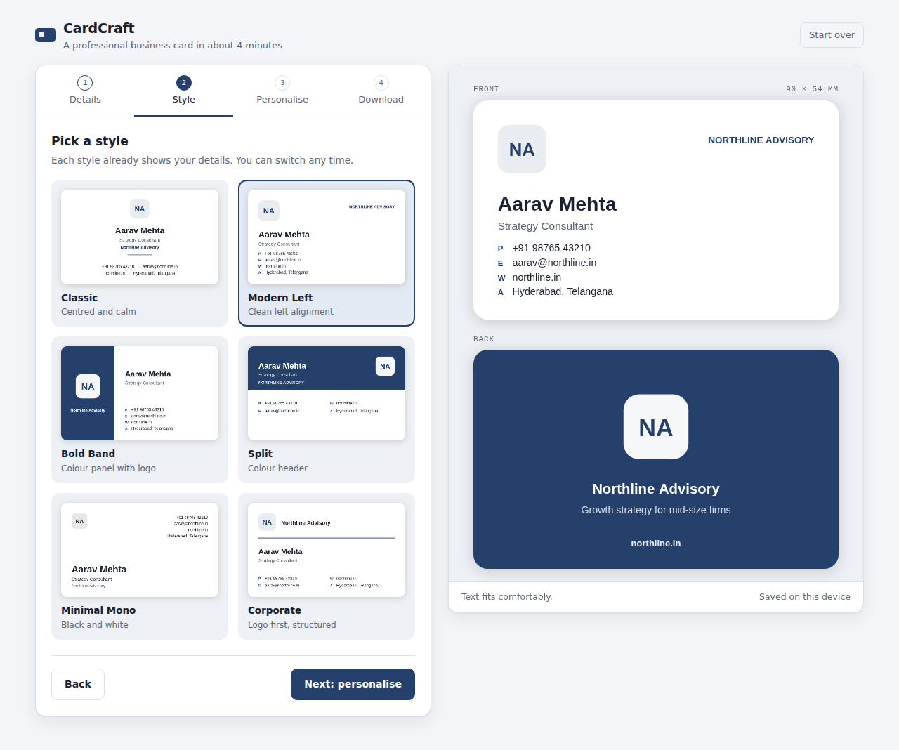

# CardCraft

Design and download a professional business card in about 4 minutes. CardCraft is for consultants, sales reps and freelancers who want a clean, print-ready card without learning a design tool.

**Try it:** https://nafees786dolphin-web.github.io/cardcraft/ (live once GitHub Pages is turned on; see below)

## What it does

Four guided steps, with a live front-and-back preview:

1. **Details:** name, title, company, phone, email, website, LinkedIn, city and tagline (only the name is required)
2. **Style:** six minimalist templates (Classic, Modern Left, Bold Band, Split, Minimal Mono, Corporate)
3. **Personalise:** logo upload in a rounded-rectangle frame, 8 accent colours plus a custom colour, 3 font styles, card corners (Square, Soft, Rounded) and card size (India 90×54 mm, US 3.5×2 in, Europe 85×55 mm)
4. **Download:** a print-ready PDF (600 DPI, front and back pages) or PNG images (300 DPI)

It has no sign-up and no server. Everything runs in your browser, and your details never leave your device. Your progress is saved in the browser, so a refresh keeps your work.

## Project files

| File | What it is |
| --- | --- |
| `index.html` | The whole app in one file (HTML, CSS and JavaScript) |
| `docs/PRD.md` | Product requirements: goals, users, features and roadmap |
| `docs/screenshot.png` | Screenshot used in this README |
| `CHANGELOG.md` | What changed in each version |

The app loads two free resources from the internet: fonts from Google Fonts and the [jsPDF](https://github.com/parallax/jsPDF) library (for PDF export) from cdnjs.

## Run it on your computer

Download `index.html` and double-click it. It opens in your browser and works as-is.

## Publish it free with GitHub Pages

1. In this repository, open **Settings → Pages**.
2. Under **Build and deployment**, set **Source** to *Deploy from a branch*.
3. Choose branch **main** and folder **/ (root)**, then click **Save**.
4. After a minute or two, the app is live at `https://nafees786dolphin-web.github.io/cardcraft/`.

Every change pushed to `main` updates the live site automatically.

## Roadmap

From the [PRD](docs/PRD.md):

- [x] **v1.0 (MVP):** details form, live preview, templates, logo, colours, fonts, double-sided cards, PDF and PNG download, auto-save
- [ ] **v1.1:** QR code on the back, show/hide toggles for each field, contact icons, vertical cards
- [ ] **v2:** vCard (.vcf) download, printable sheet of 10 cards, share a design by link
